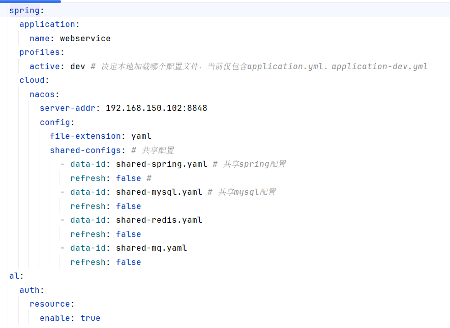

# 仿制B站-Java后端服务器-微服务版

# 部署项目

## 1 准备工作

### 1.1 环境

- 安装MySQL，推荐8.0版本
- 安装Redis，推荐6.x版本
- 安装RabbitMQ，推荐4.2.3（Erlang为27.3.4.7）
- 安装Minio，推荐RELEASE.2024-08-29T01-40-52Z

### 1.2 修改环境变量

本项目与MySQL、RabbitMQ、Redis相关的连接配置都写在Nacos的共享配置里，没有直接写在本地。你可以自己按照下图中的名字在Nacos中创建名字一样的共享配置文件，也可以直接修改本地配置。



配置文件写法示例：

```yaml
# shared-mysql.yaml
spring:
  datasource:
    username: root
    password: 123456
    driver-class-name: com.mysql.cj.jdbc.Driver
```

```yaml
# shared-redis.yaml
spring:
  data:
    redis:
      host: 192.168.150.102
      port: 6379
      password: 123456
      database: 5
```

```yaml
# shared-mq.yaml
spring:
  rabbitmq:
    host: 192.168.150.102
    port: 5672
    virtual-host: AniLink
    username: admin
    password: admin123
```


## 2 正式开始

本仓库提供Java后端工程源代码。推荐克隆main分支的源代码，其他分支为开发测试。

- 选取一个文件目录，打开命令行界面，输入：`git clone -b main https://github.com/All1217/AniLink-Java.git`
- 使用IDEA或其他方式打开
- 按需启动模块；当前可启动的仍是 `AL-gateway`、`AL-communication`、`AL-remark`、`AL-web`

## 3 模块与端口

Phase 0 已建立拆分后的模块骨架，新服务在 Phase 1–4 补启动类后启用：

| 模块 | 端口 | 作用 | 当前状态 |
| --- | --- | --- | --- |
| AL-gateway | 8090 | 网关、鉴权、路由 | 可启动 |
| AL-communication | 8023 / WS 8024 | 聊天与私信 WebSocket | 可启动 |
| AL-remark | 8021 | 点赞 | 可启动 |
| AL-web | 8022 | 迁移期兜底 | 可启动 |
| AL-user | 8025 | 账号、资料、标签 | 骨架 |
| AL-video | 8026 | 视频、投稿、转码、统计 | 骨架 |
| AL-playback | 8027 | 历史与播放进度 | 骨架 |
| AL-comment | 8028 | 评论 | 骨架 |
| AL-danmaku | 8029 / WS 8030 | 弹幕与视频房间 WebSocket | 骨架 |
| AL-social | 8031 | 关注、粉丝、收藏 | 骨架 |
| AL-datacenter | 8032 | 统计、推荐、标签聚合 BFF | 骨架 |

公共模块：`AL-common-core`、`AL-common-web`、`AL-common-mq`、`AL-common-redis`、`AL-common-mybatis`；契约模块：`AL-user-api`、`AL-video-api`、`AL-playback-api`、`AL-social-api`；架构规则：`AL-architecture-test`。

Nacos 服务名：`userservice`、`videoservice`、`playbackservice`、`socialservice`、`commentservice`、`danmakuservice`、`datacenterservice`。

新服务启用后的推荐启动顺序：`AL-gateway` → `AL-communication` → `AL-remark` → `AL-user` → `AL-video` → `AL-playback` → `AL-social` → `AL-comment` → `AL-danmaku` → `AL-datacenter` → `AL-web`（下线前）。